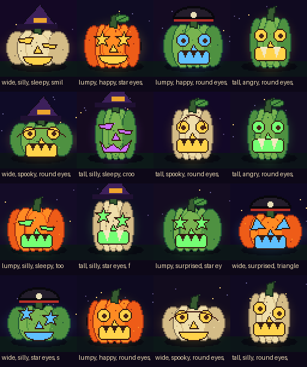
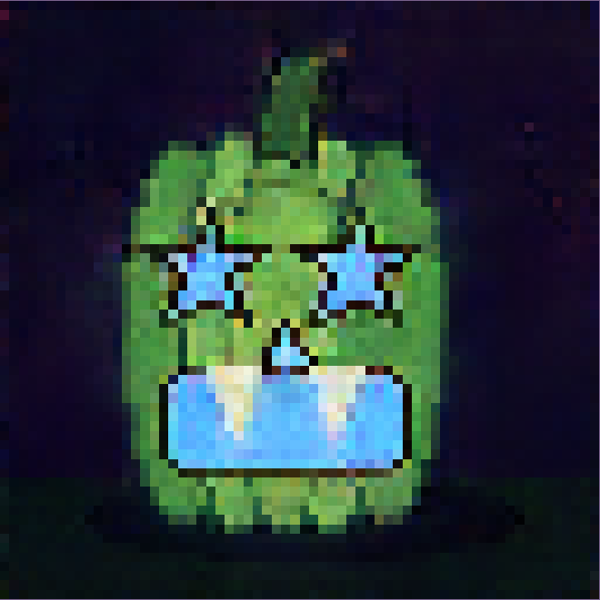
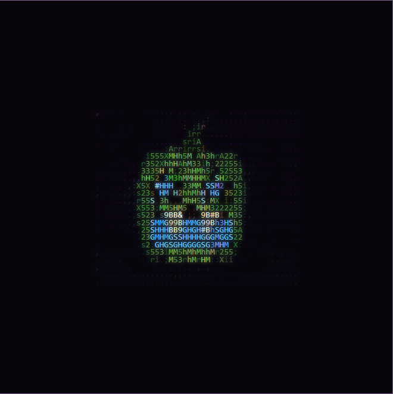

# Tiny Pumpkin Machine

Tiny Pumpkin Machine is a small, educational conditional GAN that creates
64×64 illustrated jack-o'-lanterns entirely inside a web browser. The model,
prompt parser, WebGPU/WASM inference, colored ASCII conversion, procedural
dataset, training loop, and deployment configuration are all in this repository.

There is no inference server, account, API key, telemetry, or cloud GPU. After
the static assets load, prompts and images stay on the visitor's device.

## Try it

Open the live, zero-server demo at
**[young2code.github.io/2026-Halloween-NN](https://young2code.github.io/2026-Halloween-NN/)**.

The prompt understands 100 visual words and phrases mapped onto its 28 trained
controls. Synonyms make the tiny vocabulary more playful without pretending the
model understands unrestricted language:

```text
happy round orange pumpkin with star eyes and purple glow
tall pale spooky pumpkin with sleepy eyes and fangs
silly green lumpy pumpkin with round eyes and a witch hat
```

Unknown words are shown rather than silently pretending that the model
understands unrestricted English.

## What happens when I click “Carve it”?

```text
controlled prompt
      |
      v
28-value condition vector ----+
                               |
96 seeded random values -------+--> generator.onnx --> 64x64 RGB image
                                                       |
                                     +-----------------+---------------+
                                     |                 |               |
                                  canvas          PNG download    colored ASCII
```

1. TypeScript recognizes supported words and chooses one value from each of
   seven groups: shape, expression, eyes, mouth, pumpkin color, glow, and
   accessory.
2. A seeded pseudo-random number generator creates 96 values called the
   **latent vector**. The seed makes an image reproducible.
3. The condition and latent vectors enter a compact convolutional generator.
4. ONNX Runtime Web executes that network with WebGPU where available and a
   WebAssembly CPU fallback elsewhere.
5. The browser converts the output tensor to pixels. Nothing is uploaded.

## How the colored ASCII portrait works

The ASCII view is a deterministic browser effect, not a second AI model. After
the GAN creates an RGB image, [`app/ascii.ts`](app/ascii.ts) performs four small
steps:

1. Divide the image into 44 columns. The row count compensates for text
   characters being taller than they are wide.
2. Sample the red, green, and blue values near the center of every grid cell.
3. Convert the sampled color to perceived brightness with
   `0.2126R + 0.7152G + 0.0722B`.
4. Use that brightness to choose a character from this dark-to-light ramp:

```text
 .,:;irsXA253hMHGS#9B&@
```

Each character is then wrapped in a tiny HTML element colored with its sampled
RGB value. The character describes brightness; its CSS color preserves the
original pumpkin palette. “Copy plain text” removes the colors but keeps the
characters and line breaks.

## How a conditional GAN learns

GAN means **generative adversarial network**. Training uses two networks with
opposing jobs:

- The **generator** turns random values and requested attributes into an image.
- The **discriminator** receives real procedural images and generated images.
  It learns to assign better scores to real images and to images whose labels
  agree with their appearance.

They improve through competition. The discriminator becomes a more careful
critic, while the generator learns which patterns make its output convincing.
Our training loop uses a hinge adversarial loss, a projection discriminator for
conditioning, a seven-group auxiliary attribute classifier, balanced condition
combinations, spectral normalization for stability, and an exponential moving
average (EMA) of generator weights for cleaner inference. Nearest-neighbor
upsampling followed by convolution avoids the checkerboard artifacts commonly
introduced by transposed convolutions.

After training, the discriminator has finished its teaching job. The deployed
website contains only the EMA generator, reducing download and inference cost.

### What “conditional” adds

An unconditional GAN can only answer “make a random pumpkin.” A conditional GAN
receives labels alongside random values. During training, labels describe each
real example; during inference, the prompt compiler creates the same type of
label vector. Changing `green` to `orange` changes a condition while keeping the
rest of the request and the random seed stable.

This project uses concatenated conditioning in the generator and a projection
term in the discriminator. The model is small enough to inspect in
[`training/models.py`](training/models.py).

## Where the training images come from

No external image dataset is downloaded. [`training/dataset.py`](training/dataset.py)
draws original pixel-art pumpkins with Pillow from deterministic seeds. Each
image is labeled automatically because the renderer already knows which shape,
eyes, mouth, palette, glow, and accessory it selected.

This makes the dataset:

- reproducible without committing thousands of image files;
- balanced and easy to audit;
- free of scraped images and personal information;
- useful for showing the difference between a rule-based renderer and a neural
  network that learns to imitate its distribution.

### Sample training images



These are the first 16 samples produced by the released dataset recipe. Each
caption begins with that image's automatically assigned conditions. Running
`python -m training.preview_dataset` recreates this exact grid from the fixed
seeds; it does not download any assets.

See [DATASET_CARD.md](DATASET_CARD.md) for provenance and limitations.

### Sample generated output

The two views below come from the released neural network with the same prompt
and seed—not directly from the cleaner Pillow dataset renderer above.

> **Prompt:** `tall green spooky pumpkin with star eyes fangs and blue glow`
>
> **Seed:** `4242`

| Generated 64×64 image (enlarged) | Colored ASCII translation |
|:---:|:---:|
|  |  |

The ASCII portrait contains no extra model inference. It samples this exact
generated image, chooses characters by brightness, and colors them with the
sampled RGB pixels. Run `npm run capture:readme` while the local preview server
is open to recreate both documentation images.

## Architecture

### Training path

```text
Pillow renderer -> labeled tensors -> PyTorch DataLoader
                                           |
                         +-----------------+----------------+
                         |                                  |
                    Generator                         Discriminator
                         |                                  |
                         +------ adversarial losses --------+
                         |
                    EMA checkpoint -> ONNX export -> parity check
```

### Browser path

```text
GitHub Pages (static files only)
              |
              v
     visitor downloads app + model
              |
              v
  ONNX Runtime Web: WebGPU -> WASM fallback
              |
              v
    canvas, PNG, and ASCII on device
```

GitHub Pages serves files over HTTPS but performs no model computation. Browser
inference means usage cannot create a GPU bill for the project owner.

## Repository map

```text
app/                  browser UI, prompt compiler, inference, ASCII
training/             renderer, dataset, networks, and training loop
export/               ONNX export and PyTorch/ONNX parity validation
tests/                Python architecture and reproducibility tests
public/               released ONNX model and offline service worker
.github/workflows/    CI and GitHub Pages deployment
```

## Run the website locally

Prerequisites: Node.js 20 or newer.

```powershell
npm install
npm run dev
```

Open the local URL printed by Vite. Until `public/generator.onnx` exists, the UI
will display a helpful model-loading error.

Run browser tests and create the production site:

```powershell
npm test
npm run build
npm run preview
```

## Train your own generator

An NVIDIA GPU is recommended. On Windows, the most reproducible setup uses
Conda and the CUDA-enabled environment file:

```powershell
conda env create -f environment.yml
conda activate tiny-pumpkin-machine
python -m training.preview_dataset
python -m training.train --samples 61440 --epochs 100 --batch-size 128
python -m export.export_onnx
```

### Reference training hardware and time

| Item | Released model |
|---|---:|
| Graphics card | NVIDIA GeForce RTX 4070 SUPER |
| GPUs used | 1 |
| Training samples | 61,440 balanced procedural images |
| Training epochs | 100 |
| Final training time | About 0.5 hours (30 minutes) |
| Compute used by the final run | About 0.5 GPU-hours |

These timings describe the final 100-epoch training run. They do not include
earlier architecture experiments, browser development, or documentation work.
Training time will vary with the GPU, batch size, cooling, and software setup.

Training writes checkpoints, history, and fixed-seed sample sheets under
`training/runs/`. These artifacts are ignored by Git except for the selected
ONNX generator copied to `public/`.

The export command checks the ONNX graph, compares ONNX Runtime output with
PyTorch output, and rejects a model larger than the release budget.

The released generator has 2,600,739 parameters and is 9.99 MiB. The fixed
export check measured a maximum PyTorch/ONNX error of 0.00000830.

## Tests

```powershell
python -m pytest -q
ruff check training export tests
npm test
npm run build
```

Release validation also includes a clean-browser WebGPU run, forced WASM run,
offline reload, fixed-seed comparison, keyboard review, and payload measurement.

## Deployment

The repository includes a GitHub Actions workflow that tests and builds the
static site, then uploads `dist/` to GitHub Pages. In repository settings choose
**Pages → Source → GitHub Actions**. No server, domain, Vercel account, or payment
method is required.

## Limitations and honest language

- This is not Stable Diffusion and does not understand arbitrary language.
- It only generates stylized jack-o'-lanterns in the procedural dataset's world.
- GAN training can suffer from mode collapse or imperfect condition following.
- WebGPU support varies; WASM is slower but broadly compatible.
- The native 64×64 output is enlarged with hard pixel edges rather than invented
  high-resolution detail.

See [MODEL_CARD.md](MODEL_CARD.md) for intended use and additional limitations.

## Suggested learner experiments

1. Hold the seed constant and change one condition at a time.
2. Interpolate between two latent vectors and watch features change.
3. Remove conditioning from the discriminator and compare label accuracy.
4. Change the latent dimension or channel widths and graph quality versus size.
5. Add an original procedural eye shape, retrain, and update the prompt parser.
6. Compare the live generator with the deterministic source renderer.

## References and further reading

- Ian Goodfellow et al., [Generative Adversarial Nets](https://papers.nips.cc/paper/5423-generative-adversarial-nets) (2014).
- Mehdi Mirza and Simon Osindero, [Conditional Generative Adversarial Nets](https://arxiv.org/abs/1411.1784) (2014).
- Alec Radford, Luke Metz, and Soumith Chintala, [Unsupervised Representation Learning with Deep Convolutional GANs](https://arxiv.org/abs/1511.06434) (2015).
- Takeru Miyato and Masanori Koyama, [cGANs with Projection Discriminator](https://arxiv.org/abs/1802.05637) (2018).
- Takeru Miyato et al., [Spectral Normalization for GANs](https://arxiv.org/abs/1802.05957) (2018).
- [PyTorch DCGAN tutorial](https://docs.pytorch.org/tutorials/beginner/dcgan_faces_tutorial).
- [ONNX Runtime Web overview](https://onnxruntime.ai/docs/tutorials/web/).
- [ONNX Runtime WebGPU guide](https://onnxruntime.ai/docs/tutorials/web/ep-webgpu.html).
- [WebGPU specification](https://www.w3.org/TR/webgpu/) and [MDN WebGPU guide](https://developer.mozilla.org/docs/Web/API/WebGPU_API).

The implementation was written for this repository. These sources explain the
underlying techniques; third-party libraries retain their own licenses in
[THIRD_PARTY_NOTICES.md](THIRD_PARTY_NOTICES.md).

## License

Code and the procedural dataset recipe are released under the [MIT License](LICENSE).

## AI assistance disclosure

This project was implemented with assistance from OpenAI Codex using
[GPT-5.6 Sol (`gpt-5.6-sol`)](https://developers.openai.com/api/docs/models/gpt-5.6-sol).

